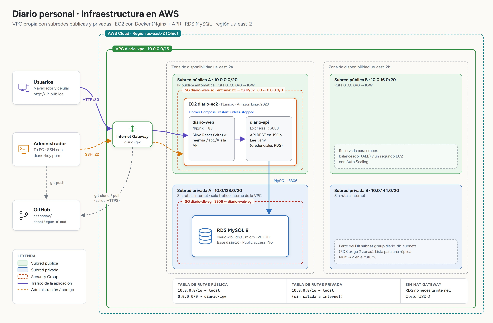
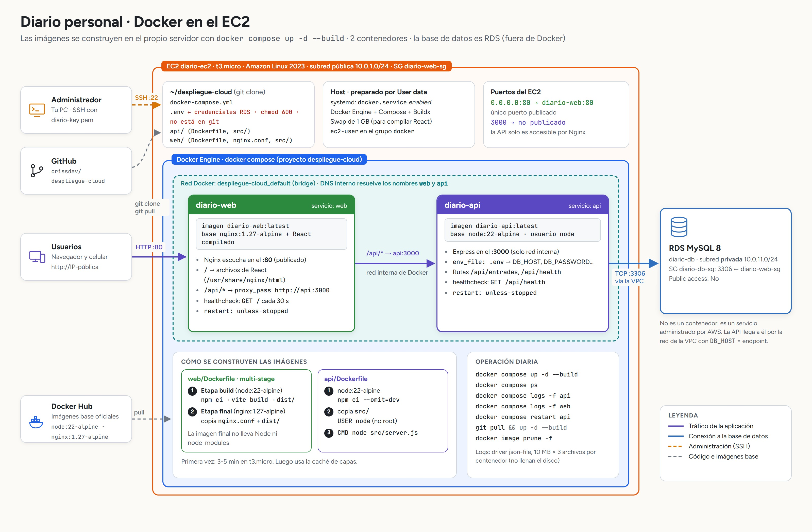

# Diario personal: despliegue en AWS (EC2 + Docker + RDS MySQL)

Aplicación web para escribir un diario personal: entradas por fecha, con **estado de ánimo**,
búsqueda y filtros. El frontend está hecho con **React + Vite** y lo sirve **Nginx**. El backend es una
**API REST con Node.js + Express**. Ambos corren en **contenedores Docker** dentro de una instancia **EC2**,
y los datos se guardan en **MySQL administrado por Amazon RDS**.

| Capa | Tecnología |
|---|---|
| Frontend | React 18 + React Router + Vite (SPA), CSS propio mobile-first, íconos SVG |
| Servidor web | Nginx 1.27 (sirve React y hace de *reverse proxy* hacia la API) |
| Backend | Node.js 22 + Express 4 (API REST en JSON) + mysql2 |
| Base de datos | MySQL 8 en Amazon RDS (en local: contenedor MySQL 8.4) |
| Infraestructura | Docker + Docker Compose sobre EC2 (Amazon Linux 2023), VPC propia |

Proyecto de práctica para:
1. Crear y administrar una instancia **EC2**, con acceso **SSH** y reglas del **Security Group**.
2. Desplegar una aplicación web con **Docker** y comprobar que se accede desde el navegador.
3. Crear una base **MySQL en RDS** y conectarla con la aplicación en EC2.
4. **Diagnosticar y solucionar** errores de servicios, logs, contenedores y conectividad.

## Arquitectura

Definición completa: **[docs/ARQUITECTURA.md](docs/ARQUITECTURA.md)** (componentes, plan de IPs, seguridad,
flujos, decisiones, limitaciones y costos).



Detalle de Docker dentro del EC2 (imágenes, contenedores, red interna y puertos):



```
                 Usuario (HTTP :80)        Administrador (SSH :22, solo su IP)
                          \                    /
                           ▼                  ▼
┌─────────────────────────── VPC diario-vpc 10.0.0.0/16 ───────────────────────────┐
│                         [ Internet Gateway diario-igw ]                           │
│                                      │                                            │
│   Zona us-east-1a                    │                 Zona us-east-1b            │
│  ┌─ Subred pública A 10.0.1.0/24 ────▼──────────┐   ┌─ Subred pública B ────────┐ │
│  │  [SG diario-web-sg]                          │   │  10.0.2.0/24 (reserva)    │ │
│  │  EC2 t3.micro · Docker                       │   └───────────────────────────┘ │
│  │   :80 ▶ [diario-web] Nginx + React           │                                 │
│  │            │ /api/*                          │                                 │
│  │            ▼                                 │                                 │
│  │         [diario-api] Express :3000           │                                 │
│  └──────────────────────┬───────────────────────┘                                 │
│                         │ MySQL :3306                                             │
│  ┌─ Subred privada A 10.0.11.0/24 ──▼───────────┐   ┌─ Subred privada B ────────┐ │
│  │  [SG diario-db-sg]                           │   │  10.0.12.0/24             │ │
│  │  RDS MySQL db.t3.micro · sin acceso público  │   │  (DB subnet group)        │ │
│  └──────────────────────────────────────────────┘   └───────────────────────────┘ │
│  Rutas públicas: 0.0.0.0/0 → IGW   ·   Rutas privadas: solo local (sin internet)  │
└───────────────────────────────────────────────────────────────────────────────────┘
```

**Decisiones clave:**
- **VPC propia** con subredes públicas (web) y privadas (base de datos) en 2 zonas de disponibilidad, **sin NAT Gateway** (costo cero).
- **RDS en subredes privadas** y sin acceso público: la base solo es accesible desde dentro de la VPC.
- **Dos contenedores:** `diario-web` (Nginx, el único con puerto publicado, el 80) y `diario-api` (Express, solo accesible desde Nginx).
- **Las imágenes Docker se construyen en el EC2** a partir del código en GitHub (sin ECR). El frontend usa un build *multi-stage*: Node compila React y la imagen final solo lleva Nginx.
- **Encadenamiento de Security Groups:** RDS acepta el puerto 3306 **solo** desde instancias con `diario-web-sg`, no desde IPs.
- **SSH restringido a tu IP**, y HTTP abierto para que la web sea pública.
- **Credenciales en `.env`**, que se queda en el servidor y nunca entra a git.
- **`/api/health`:** un endpoint que dice si la API y la conexión a RDS están bien (es la base del diagnóstico).
- **`restart: unless-stopped`:** los contenedores se levantan solos tras caídas o reinicios del EC2.

## Estructura del repositorio

```
web/                     FRONTEND (React + Vite, servido por Nginx)
  src/main.jsx           punto de entrada de React
  src/App.jsx            rutas de la SPA (React Router)
  src/paginas/           Inicio, VerEntrada, FormularioEntrada
  src/componentes/       Plantilla (cabecera/pie), íconos SVG, estados de carga y error
  src/api.js             cliente de la API (fetch) con mensajes para 502/503/504
  src/styles.css         estilos mobile-first (modo claro y oscuro)
  nginx.conf             sirve React y reenvía /api → api:3000
  Dockerfile             multi-stage: Node compila → Nginx sirve
api/                     BACKEND (API REST)
  src/server.js          rutas /api/entradas (GET, POST, PUT, DELETE), /api/health
  src/db.js              conexión a MySQL y creación automática de la tabla
  Dockerfile             Node 22 Alpine, usuario no-root, healthcheck
db/init.sql              esquema de la tabla + datos de ejemplo
docker-compose.yml       producción en EC2 (web + api; la BD es RDS)
docker-compose.local.yml pruebas en tu PC (agrega un MySQL local que simula RDS)
.env.example             plantilla de configuración
scripts/instalar-docker.sh  prepara el EC2 (Docker, Compose, Git, cliente MySQL)
docs/LOCAL.md               guía para levantarlo en tu PC con Docker
docs/ARQUITECTURA.md        definición de la arquitectura (diagramas, red, seguridad, decisiones)
docs/PLAN-DESPLIEGUE.md     plan: fases, orden, tiempos, controles, evidencias y riesgos
docs/DESPLIEGUE.md          guía paso a paso: consola de AWS + comandos CLI
docs/SOLUCION-DE-ERRORES.md diagnóstico, fallas típicas y laboratorio de fallas
```

## Funcionalidades

- Crear, ver, editar y eliminar entradas del diario.
- Seis estados de ánimo con íconos propios, colores y conteo por ánimo.
- Búsqueda mientras escribes y filtro por ánimo (los filtros quedan en la URL).
- Diseño mobile-first: botón flotante, barra de guardar fija y casillas táctiles grandes.
- `/api/health` con el estado en JSON: API, conexión a BD, versión de MySQL y latencia.
- Contraseña opcional (HTTP Basic) definiendo `APP_PASSWORD` en `.env`.
- Nada se cae del todo si falla una capa: la interfaz explica qué falló (502, 503 o 504), ofrece *Reintentar* y la API se reconecta sola a la BD.

### API REST

| Método | Ruta | Descripción |
|---|---|---|
| `GET` | `/api/entradas?q=&animo=` | Lista (máx. 200) + conteo por ánimo |
| `GET` | `/api/entradas/:id` | Una entrada |
| `POST` | `/api/entradas` | Crear: `{fecha, titulo, contenido, animo}` → `201` |
| `PUT` | `/api/entradas/:id` | Actualizar → `200` |
| `DELETE` | `/api/entradas/:id` | Eliminar → `204` |
| `GET` | `/api/health` | Estado de la API y de la base de datos |

Si los datos no son válidos, la API responde `400 {"errores": {"campo": "mensaje"}}`.

## Probar en tu PC (opcional, antes de AWS)

Guía detallada: **[docs/LOCAL.md](docs/LOCAL.md)**. Versión corta (requiere Docker Desktop):
```powershell
Copy-Item .env.example .env      # pon cualquier contraseña en DB_PASSWORD
docker compose -f docker-compose.yml -f docker-compose.local.yml up -d --build
# Abre http://localhost:8080  y  http://localhost:8080/api/health
docker compose -f docker-compose.yml -f docker-compose.local.yml down
```

## Desplegar en AWS

Empieza por el **[plan de despliegue](docs/PLAN-DESPLIEGUE.md)**, que da el orden, los tiempos y los controles de cada fase.
El detalle de cada paso está en **[docs/DESPLIEGUE.md](docs/DESPLIEGUE.md)**. En resumen:
1. Crear la red: VPC `10.0.0.0/16`, 2 subredes públicas, 2 privadas, Internet Gateway y tablas de rutas.
2. Crear los Security Groups `diario-web-sg` y `diario-db-sg`.
3. Crear el key pair, el EC2 (en la subred pública) y RDS (en las subredes privadas, con un DB subnet group).
4. Entrar por SSH, instalar Docker, `git clone`, configurar `.env` y ejecutar `docker compose up -d --build`.
5. Abrir `http://<IP-pública-EC2>`.

Si algo falla, consulta **[docs/SOLUCION-DE-ERRORES.md](docs/SOLUCION-DE-ERRORES.md)**.

## Costos

La VPC, las subredes, el IGW, las rutas y los SG no tienen costo, y no usamos NAT Gateway.
Con Free Tier: EC2 t3.micro y RDS db.t3.micro tienen 750 horas al mes gratis cada uno, y RDS incluye 20 GB.
Las **IPv4 públicas se cobran por hora**. **Borra los recursos al terminar** (ver la sección 12 de la guía)
y crea una alerta de presupuesto en *Billing → Budgets*.
