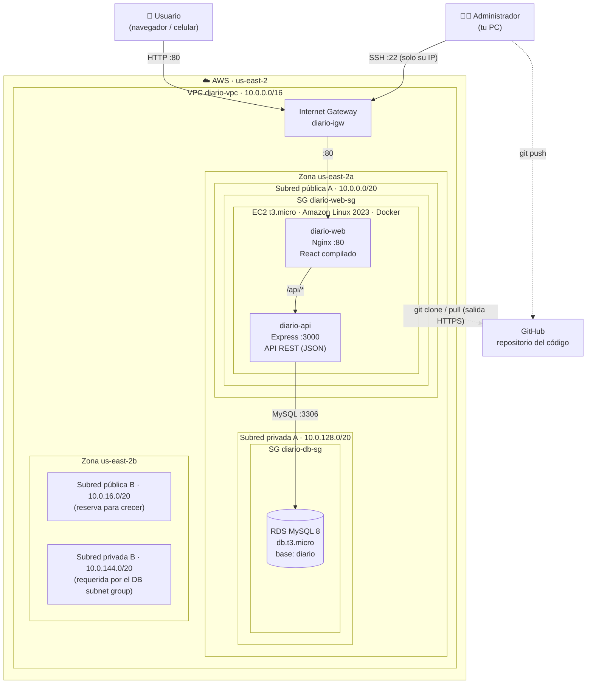
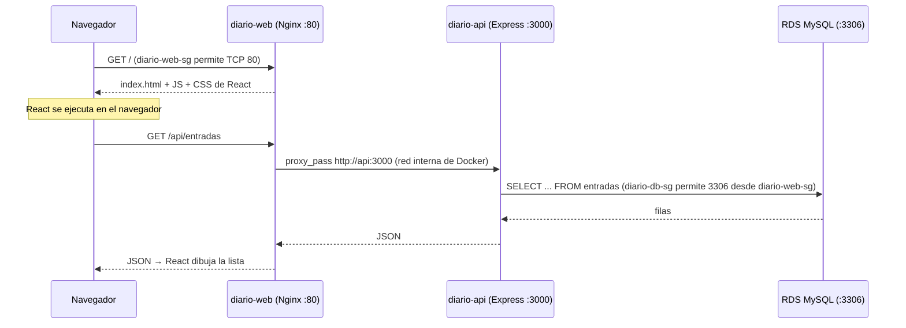

# Arquitectura: Diario personal en AWS

| | |
|---|---|
| **Aplicación** | Diario personal: frontend **React 18 + Vite** (SPA) y backend **API REST con Node.js 22 + Express** |
| **Modelo** | Una instancia EC2 con 2 contenedores Docker (**Nginx** + **API**) y una base de datos administrada RDS MySQL |
| **Red** | VPC propia `10.0.0.0/16` con subredes **públicas** (web) y **privadas** (base de datos) en 2 zonas de disponibilidad |
| **Despliegue** | Código en GitHub → `git pull` en el EC2 → `docker compose up -d --build` |
| **Región** | `us-east-2` (Ohio); zonas `us-east-2a` y `us-east-2b` |
| **Costo objetivo** | Dentro de la capa gratuita (Free Tier) |

---

## 1. Diagrama general



Versión en texto, por si el visor no muestra Mermaid:

```
                 Usuario (HTTP :80)        Administrador (SSH :22, solo su IP)
                          \                    /
                           ▼                  ▼
┌─────────────────────────── VPC diario-vpc 10.0.0.0/16 ───────────────────────────┐
│                         [ Internet Gateway diario-igw ]                           │
│                                      │                                            │
│   Zona us-east-2a                    │                 Zona us-east-2b            │
│  ┌─ Subred pública A 10.0.0.0/20 ────▼──────────┐   ┌─ Subred pública B ────────┐ │
│  │  [SG diario-web-sg]                          │   │  10.0.16.0/20 (reserva)    │ │
│  │  EC2 t3.micro · Docker                       │   └───────────────────────────┘ │
│  │   :80 ▶ [diario-web] Nginx + React           │                                 │
│  │            │ /api/*                          │                                 │
│  │            ▼                                 │                                 │
│  │         [diario-api] Express :3000           │                                 │
│  └──────────────────────┬───────────────────────┘                                 │
│                         │ MySQL :3306                                             │
│  ┌─ Subred privada A 10.0.128.0/20 ──▼───────────┐   ┌─ Subred privada B ────────┐ │
│  │  [SG diario-db-sg]                           │   │  10.0.144.0/20             │ │
│  │  RDS MySQL db.t3.micro · sin acceso público  │   │  (DB subnet group)        │ │
│  └──────────────────────────────────────────────┘   └───────────────────────────┘ │
│  Tabla de rutas pública:  10.0.0.0/16 → local   ·   0.0.0.0/0 → diario-igw        │
│  Tabla de rutas privada:  10.0.0.0/16 → local   (sin salida a internet)           │
└───────────────────────────────────────────────────────────────────────────────────┘
```

---

## 2. Componentes

| Capa | Recurso AWS | Nombre | Configuración | Para qué sirve |
|---|---|---|---|---|
| Red | VPC | `diario-vpc` | `10.0.0.0/16`, DNS resolution y DNS hostnames activados | Red privada y aislada del proyecto |
| Red | Internet Gateway | `diario-igw` | Conectado a `diario-vpc` | Puerta entre la VPC e internet |
| Red | Subred pública A | `diario-public-a` | `10.0.0.0/20`, `us-east-2a`, asigna IP pública automáticamente | Aloja el EC2 |
| Red | Subred pública B | `diario-public-b` | `10.0.16.0/20`, `us-east-2b` | Reserva para un segundo EC2 o un balanceador (ALB) |
| Red | Subred privada A | `diario-private-a` | `10.0.128.0/20`, `us-east-2a` | Aloja RDS |
| Red | Subred privada B | `diario-private-b` | `10.0.144.0/20`, `us-east-2b` | RDS exige subredes en ≥ 2 zonas |
| Red | Tabla de rutas | `diario-rt-public` | `0.0.0.0/0 → diario-igw`; asociada a las subredes públicas | Les da salida a internet a las subredes públicas |
| Red | Tabla de rutas | `diario-rt-private` | Solo la ruta `local`; asociada a las subredes privadas | Deja a las subredes privadas sin internet |
| Seguridad | Security Group | `diario-web-sg` | Entrada: 22 desde tu IP, 80 desde `0.0.0.0/0` | Firewall del EC2 |
| Seguridad | Security Group | `diario-db-sg` | Entrada: 3306 **solo desde `diario-web-sg`** | Firewall de RDS |
| Seguridad | Key Pair | `diario-key` | RSA, `.pem` | Acceso SSH al EC2 |
| Cómputo | EC2 | `diario-ec2` | t3.micro, Amazon Linux 2023, 8 GiB gp3, subred pública A | Servidor de la aplicación |
| Contenedor | Docker + Compose | `diario-web` | Nginx 1.27 Alpine con React compilado (build multi-stage), healthcheck, `restart: unless-stopped`. Único puerto publicado: **80** | Sirve el frontend y reenvía `/api/*` a la API (reverse proxy) |
| Contenedor | Docker + Compose | `diario-api` | Node 22 Alpine, usuario no-root, healthcheck. Puerto 3000 **solo dentro de la red de Docker** | API REST en JSON; único componente que habla con RDS |
| Datos | RDS subnet group | `diario-db-subnets` | Subredes privadas A y B | Le dice a RDS en qué subredes puede vivir |
| Datos | RDS MySQL | `diario-db` | MySQL 8, db.t3.micro, 20 GiB, Single-AZ, **Public access: No** | Base de datos administrada |
| Código | GitHub | `despliegue-cloud` | Repositorio público o privado | Fuente del código que se despliega |

---

## 3. Plan de direcciones IP

| Red | CIDR | Direcciones | Uso |
|---|---|---|---|
| VPC | `10.0.0.0/16` | 65 536 | Todo el proyecto |
| Pública A | `10.0.0.0/20` | 4 091 utilizables* | EC2 |
| Pública B | `10.0.16.0/20` | 4 091 utilizables* | Crecimiento futuro |
| Privada A | `10.0.128.0/20` | 4 091 utilizables* | RDS (instancia principal) |
| Privada B | `10.0.144.0/20` | 4 091 utilizables* | RDS (requisito del subnet group / futuro Multi-AZ) |

\* AWS reserva 5 direcciones por subred: la de red, la `.1` del router, la `.2` del DNS, la `.3` reservada y la de broadcast.

**¿Qué hace "pública" o "privada" a una subred?** Solo su **tabla de rutas**. Una subred es
pública si tiene la ruta `0.0.0.0/0 → Internet Gateway`. Las privadas no tienen esa ruta,
así que **nada dentro de ellas puede ser alcanzado desde internet**, aunque se configure mal.

---

## 4. Seguridad

### 4.1 Security Groups

| SG | Dirección | Protocolo / puerto | Origen o destino | Justificación |
|---|---|---|---|---|
| `diario-web-sg` | Entrada | TCP 22 (SSH) | `<tu IP>/32` | Solo el administrador entra al servidor |
| `diario-web-sg` | Entrada | TCP 80 (HTTP) | `0.0.0.0/0` | La aplicación es pública |
| `diario-web-sg` | Salida | Todo | `0.0.0.0/0` | Actualizar paquetes, `git pull`, descargar imágenes y hablar con RDS |
| `diario-db-sg` | Entrada | TCP 3306 (MySQL) | **SG `diario-web-sg`** | Solo el servidor web habla con la base |
| `diario-db-sg` | Salida | Todo | `0.0.0.0/0` | Valor por defecto (los SG son *stateful*: las respuestas siempre salen) |

Las reglas se basan en **referencias entre Security Groups**, no en IPs. Si el EC2 cambia de IP
o se agrega otro servidor con `diario-web-sg`, el acceso a la base sigue funcionando sin tocar nada.

### 4.2 Defensa en capas

1. **Red:** RDS vive en subredes **sin ruta a internet** y además tiene *Public access: No*.
2. **Firewall:** `diario-db-sg` solo acepta el 3306 desde el SG web, y SSH solo se permite desde una IP.
3. **Acceso al servidor:** se entra únicamente con la llave `.pem`; las contraseñas SSH están desactivadas en Amazon Linux.
4. **Secretos:** las credenciales de la BD están en `.env` dentro del EC2 (`chmod 600`), **fuera de git**.
5. **Contenedores:** solo Nginx publica un puerto (80). La API (3000) no es accesible desde fuera del EC2, solo a través de Nginx.
   La API corre como usuario `node` (no root). La imagen web no incluye Node, solo Nginx y archivos estáticos.
6. **Aplicación:** la API usa consultas parametrizadas (no hay inyección SQL) y valida los datos. React escapa el texto
   automáticamente (no hay XSS). Nginx envía encabezados de seguridad (`X-Frame-Options`, `X-Content-Type-Options`) y oculta su versión.
   Se puede proteger el diario con usuario y contraseña (`APP_PASSWORD`).
7. **Opcional:** cifrar la conexión con la base usando TLS (`DB_SSL=true`, con los certificados de Amazon RDS).

Las Network ACLs se dejan con los valores por defecto (todo permitido) y el control se hace con los Security Groups.

---

## 5. Flujos

### 5.1 Petición de un usuario



1. La primera visita descarga la **aplicación React** (archivos estáticos) desde Nginx.
2. A partir de ahí, el navegador solo pide **datos en JSON** a `/api/...`.
3. Nginx reenvía esas peticiones a la API por la **red interna de Docker**, usando el nombre `api`, que resuelve el DNS de Docker.
4. Si el usuario recarga en `/entradas/5`, Nginx devuelve `index.html` (`try_files`) y React Router muestra la entrada.

### 5.2 Despliegue y actualización

```
Tu PC                     GitHub                 EC2 (por SSH)
──────                    ──────                 ─────────────
git commit + git push ──▶ repositorio ──────────▶ git pull
                                                  docker compose up -d --build
                                                   ├─ api/Dockerfile → imagen diario-api
                                                   ├─ web/Dockerfile (multi-stage):
                                                   │    1. node: npm ci + vite build → dist/
                                                   │    2. nginx + dist/ → imagen diario-web
                                                   ├─ recrea los contenedores (api usa .env)
                                                   └─ la API crea la tabla si no existe
                                                  curl localhost/api/health  ✔
```

Las imágenes **se construyen en el propio EC2**. No usamos un registro de imágenes (ECR), así que
no hace falta IAM ni hay costos extra. A cambio, cada despliegue tarda lo que dure el build:
la primera vez entre 3 y 5 minutos en un t3.micro, por la compilación de React. El script de
instalación crea 1 GB de swap para que ese build no se quede sin memoria.

### 5.3 Administración

- **SSH:** `ssh -i diario-key.pem ec2-user@<IP pública>`, solo desde la IP autorizada.
- **Base de datos:** se administra **desde el EC2**, que hace de "puente":
  `mysql -h <endpoint> -u admin -p`. Desde tu PC no hay acceso directo, y eso es intencional.

---

## 6. Observabilidad y diagnóstico

| Qué | Dónde | Uso |
|---|---|---|
| Salud de la API y la BD | `GET /api/health` (JSON) | Ver de un vistazo si fallan la API, la red o las credenciales |
| Healthcheck de Docker | `docker compose ps` → `(healthy)` | Docker revisa `/` en Nginx y `/api/health` en la API cada 30 s |
| Logs de Nginx | `docker logs diario-web` | Cada petición con su código HTTP. Aquí aparecen los **502** cuando la API está caída |
| Logs de la API | `docker logs diario-api` | Cada petición, cada error y cada reintento de conexión a la BD |
| Errores en el navegador | La interfaz muestra un mensaje según el código (502, 503, 504) y un botón *Reintentar* | Saber qué capa falló sin abrir la terminal |
| Servicio Docker | `systemctl status docker`, `journalctl -u docker` | Estado del motor de contenedores |
| Arranque del EC2 | `/var/log/cloud-init-output.log`, *Get system log* | Ver si el script User data falló |
| RDS | Consola → *Logs & events*, *Monitoring* | Reinicios, conexiones, CPU y almacenamiento |

El detalle de diagnóstico está en [SOLUCION-DE-ERRORES.md](SOLUCION-DE-ERRORES.md).

---

## 7. Decisiones de arquitectura

| # | Decisión | Alternativa descartada | Motivo |
|---|---|---|---|
| 1 | VPC propia con subredes públicas y privadas | VPC default | Aislar la BD a nivel de red y aprender VPC, subredes, IGW y rutas |
| 2 | **Sin NAT Gateway** | NAT Gateway para las subredes privadas | RDS no necesita salir a internet, y un NAT cuesta unos USD 32 al mes |
| 3 | 2 zonas de disponibilidad, pero 1 sola instancia | Multi-AZ real | RDS exige 2 AZ en su subnet group. Así la red queda lista para crecer sin pagar duplicado |
| 4 | Un solo EC2 con IP pública | ALB + Auto Scaling | Free Tier y simplicidad. El ALB cuesta unos USD 16 al mes |
| 5 | Docker Compose | Apache o Node instalados directamente | Entorno reproducible, igual en la PC y en AWS, fácil de diagnosticar |
| 5b | Frontend en **React + Vite** (SPA) y backend como **API REST** | Plantillas renderizadas en el servidor (EJS) | Separa interfaz y datos, que es el estándar de la industria. La API se podría reutilizar desde una app móvil |
| 5c | **Nginx** en su propio contenedor como servidor web y *reverse proxy* | Que Express sirva también los archivos de React | Nginx sirve archivos estáticos con más eficiencia, aísla la API (no expone el 3000) y permite practicar el diagnóstico de errores 502 y 504 |
| 6 | Build en el EC2 desde GitHub | Amazon ECR | Menos piezas (sin IAM ni registro) y sin costo |
| 7 | RDS MySQL | MySQL en un contenedor del EC2 | Respaldos, parches y monitoreo administrados por AWS. Es el objetivo de la práctica |
| 8 | Secretos en `.env` | AWS Secrets Manager | Simplicidad. Secrets Manager cuesta unos USD 0.40 al mes por secreto |
| 9 | HTTP sin TLS | HTTPS con dominio y certificado | No hay dominio propio. Es una limitación conocida |

---

## 8. Limitaciones conocidas

| Limitación | Impacto | Cómo se resolvería |
|---|---|---|
| Un solo EC2 | Si el EC2 se cae, la web se cae | ALB + Auto Scaling con 2 instancias (en las subredes públicas A y B) |
| RDS Single-AZ | Si falla la AZ `us-east-2a`, se pierde el servicio de la base | Activar *Multi-AZ*: la subred privada B ya está lista |
| IP pública dinámica | Cambia al detener e iniciar el EC2 | Elastic IP o un dominio en Route 53 |
| Solo HTTP | Lo que viaja por la red no va cifrado | Dominio + certificado (ACM en un ALB, o Let's Encrypt en el EC2) |
| Secretos en un archivo | Quien entre al EC2 puede leerlos | Secrets Manager o SSM Parameter Store, con un IAM Role |
| Logs solo en Docker | Se pierden si se borra el EC2 | CloudWatch Logs (driver `awslogs`) |

### Evolución posible (no incluida en esta práctica)

```
Internet → ALB (subredes públicas A+B) → Auto Scaling 2× EC2 → RDS Multi-AZ (privadas A+B)
                                             ↑ imagen desde ECR, secretos en Secrets Manager
```

---

## 9. Costos estimados

| Recurso | Free Tier | Fuera del Free Tier (aprox., us-east-2) |
|---|---|---|
| EC2 t3.micro | 750 h/mes | ~USD 7.6/mes |
| EBS 8 GiB gp3 | 30 GiB/mes | ~USD 0.64/mes |
| RDS db.t3.micro Single-AZ | 750 h/mes + 20 GiB | ~USD 12.4/mes + almacenamiento |
| IPv4 pública | 750 h/mes (cuentas con Free Tier de 12 meses) | ~USD 3.6/mes |
| VPC, subredes, IGW, rutas, SG | Gratis | Gratis |
| Transferencia de salida | 100 GB/mes | USD 0.09/GB |

> Los beneficios del Free Tier dependen del tipo de cuenta y de su antigüedad. Revisa *Billing → Free Tier*,
> crea una alerta en *Billing → Budgets* y **borra los recursos al terminar** (sección 12 de [DESPLIEGUE.md](DESPLIEGUE.md)).
