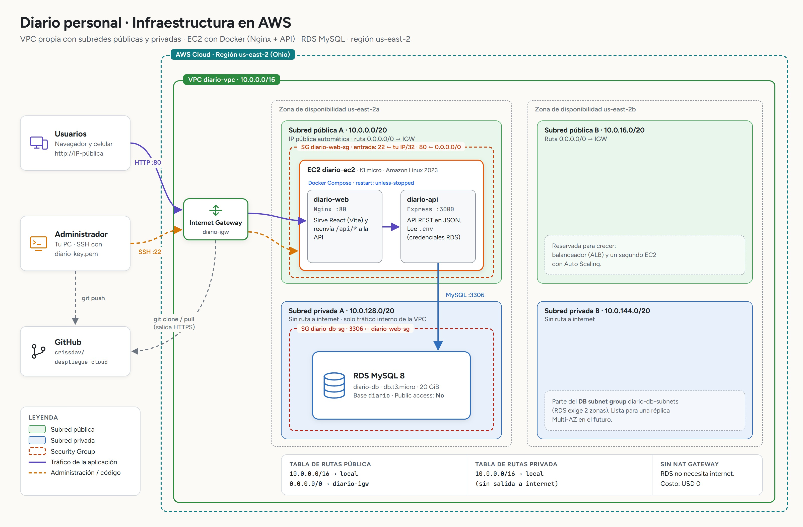
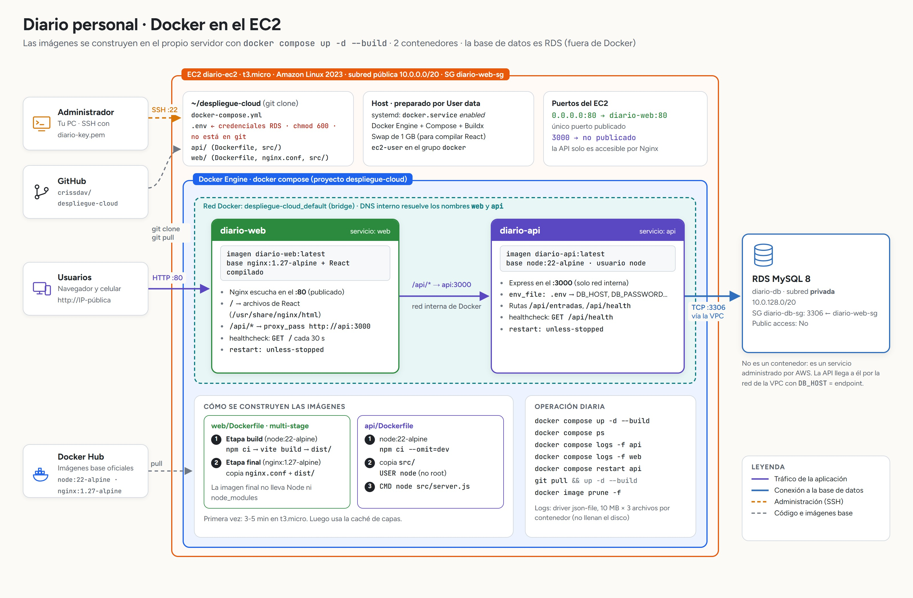
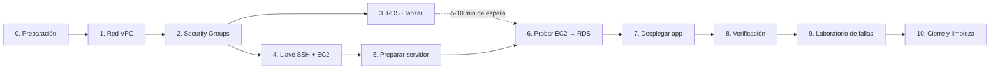

# Plan de despliegue en AWS: Diario personal

| | |
|---|---|
| **Objetivo** | Dejar la aplicación funcionando en `http://<IP-pública-EC2>` con la arquitectura de [ARQUITECTURA.md](ARQUITECTURA.md), y cumplir los 4 puntos de la práctica con evidencias |
| **Qué se despliega** | `diario-web` (Nginx + React) y `diario-api` (Express) en un EC2, más la base MySQL en RDS, dentro de una VPC propia |
| **Repositorio** | <https://github.com/crissdav/despliegue-cloud> (público, rama `main`) |
| **Región** | `us-east-2` (Ohio); zonas `us-east-2a` y `us-east-2b` |
| **Duración estimada** | Unas **2 h 30 min** de despliegue, más **1 h** de laboratorio de fallas |
| **Costo esperado** | USD 0 dentro del Free Tier, si se borran los recursos al terminar (fase 10) |
| **Forma de despliegue** | **Docker Compose en el EC2**: el servidor clona el repo y construye las imágenes con `docker compose up -d --build` (sin ECR) |
| **Guía de pasos (clics y comandos)** | [DESPLIEGUE.md](DESPLIEGUE.md). Este plan indica el orden, los controles y las evidencias; la guía, el detalle de cada paso |

---

## 0. Qué vamos a construir

### Infraestructura en AWS



| Recurso | Configuración | Fase |
|---|---|---|
| VPC `diario-vpc` | `10.0.0.0/16`, 2 zonas, Internet Gateway, sin NAT Gateway | 1 |
| Subredes públicas | `10.0.0.0/20` (EC2), `10.0.16.0/20` (reserva) · ruta `0.0.0.0/0 → IGW` | 1 |
| Subredes privadas | `10.0.128.0/20` (RDS), `10.0.144.0/20` (subnet group) · solo ruta `local` | 1 |
| `diario-web-sg` | 22 ← tu IP · 80 ← `0.0.0.0/0` | 2 |
| `diario-db-sg` | 3306 ← `diario-web-sg` | 2 |
| RDS `diario-db` | MySQL 8, db.t3.micro, 20 GiB, **Public access: No** | 3 |
| EC2 `diario-ec2` | t3.micro, Amazon Linux 2023 o Ubuntu 24.04, subred pública A, *User data* = `instalar-docker.sh` | 4 |

### Docker dentro del EC2



| Pieza | Qué es | Quién la crea |
|---|---|---|
| Docker Engine + Compose + Buildx + swap de 1 GB | Software del servidor | El script de *User data* (fase 4), solo, en el primer arranque |
| `~/despliegue-cloud` | El código clonado desde GitHub | Tú, con `git clone` (fase 7) |
| `.env` | Credenciales de RDS. **No está en git**, `chmod 600` | Tú, con `nano` (fase 7) |
| Imagen `diario-web` | Build *multi-stage*: Node compila React → Nginx 1.27 lo sirve | `docker compose up -d --build` (fase 7) |
| Imagen `diario-api` | Node 22 + Express, usuario `node` | `docker compose up -d --build` (fase 7) |
| Contenedor `diario-web` | Nginx en el **puerto 80** (el único publicado); reenvía `/api/*` a `api:3000` | Compose |
| Contenedor `diario-api` | Express en el **3000, solo red interna**; se conecta a RDS con `.env` | Compose |
| Red interna de Docker | Los contenedores se encuentran por nombre (`web`, `api`) | Compose |

Solo se usa `docker-compose.yml`. El archivo `docker-compose.local.yml` es exclusivo de tu PC, porque agrega un MySQL falso.

---

## 1. Estado de partida

| Ítem | Estado |
|---|---|
| App probada en local con Docker (3 contenedores *healthy*) | ✅ Listo |
| Código commiteado y subido a GitHub, repo público | ✅ Listo |
| Script de preparación del EC2 (`scripts/instalar-docker.sh`, con Docker, Compose, Git y swap) | ✅ Listo |
| Cuenta de AWS | ✅ Disponible |
| AWS CLI en tu PC | ❌ No instalada: se usará la **consola web**, y **CloudShell** para la CLI |

---

## 2. Hoja de datos del despliegue

Complétala a medida que avanzas. Muchos pasos necesitan un valor de una fase anterior.
**No subas esta hoja con contraseñas a git.** Cópiala a un archivo fuera del repo o a papel.

| Dato | Se obtiene en | Valor |
|---|---|---|
| Tu IP pública (`x.x.x.x/32`) | Fase 0 | |
| Contraseña de la BD (`admin`) | Fase 0 | *(no la anotes aquí)* |
| VPC ID (`vpc-…`) | Fase 1 | |
| Subred pública A (`subnet-…`) | Fase 1 | |
| Subredes privadas A y B | Fase 1 | |
| SG web (`sg-…`) | Fase 2 | |
| SG db (`sg-…`) | Fase 2 | |
| Ruta del archivo `diario-key.pem` | Fase 4 | `C:\claves-aws\diario-key.pem` |
| Endpoint de RDS | Fase 3 | |
| Sistema operativo y usuario SSH (`ec2-user` o `ubuntu`) | Fase 4 | |
| Instance ID (`i-…`) | Fase 4 | |
| IP pública del EC2 | Fase 4 | |

---

## 3. Orden y dependencias



**Clave para ahorrar tiempo:** RDS tarda entre 5 y 10 minutos en crearse. Lánzala (fase 3) **antes** que el EC2,
y mientras se crea, avanza con las fases 4 y 5. Cuando llegues a la fase 6, la base ya estará lista.

| Fase | Duración | Acumulado |
|---|---|---|
| 0. Preparación de la cuenta | 15 min | 0:15 |
| 1. Red | 20 min | 0:35 |
| 2. Security Groups | 10 min | 0:45 |
| 3. RDS (lanzar; se crea en paralelo) | 10 min | 0:55 |
| 4. Par de claves + EC2 | 15 min | 1:10 |
| 5. Preparar el servidor | 20 min | 1:30 |
| 6. Conectividad EC2 → RDS | 10 min | 1:40 |
| 7. Desplegar la aplicación | 20 min | 2:00 |
| 8. Verificación y evidencias | 20 min | 2:20 |
| 9. Laboratorio de fallas | 60 min | 3:20 |
| 10. Cierre y limpieza | 15 min | 3:35 |

Puedes hacerlo en **dos sesiones**: fases 0 a 8 el primer día y fases 9 y 10 el segundo. Entre ambas,
**detén** el EC2 y la RDS (ver fase 10, opción "pausar") para no consumir horas.

---

## 4. Fases

Cada fase tiene un **control de salida**: no avances si no se cumple. La mayoría de los problemas
difíciles de encontrar vienen de saltarse un control y descubrir el error dos fases después.

### Fase 0: Preparación de la cuenta (15 min)

**Objetivo:** cuenta segura, región correcta y control de costos activo antes de crear nada.

- [ ] Inicia sesión en la consola y elige la región **US East (Ohio) `us-east-2`** (arriba a la derecha).
- [ ] Activa **MFA** en el usuario raíz (*Security credentials → Assign MFA*), si aún no está activo.
- [ ] Crea una alerta de costos: **Billing → Budgets → Create budget → Zero spend budget** (te avisa por correo con el primer centavo).
- [ ] Revisa **Billing → Free Tier**: confirma qué servicios y horas tienes disponibles.
- [ ] Anota **tu IP pública**: abre <https://checkip.amazonaws.com> en tu PC.
- [ ] Define la **contraseña de la BD** (8 o más caracteres, sin `/ " @` ni espacios).
- [ ] Crea la carpeta para las llaves: `C:\claves-aws\` (ahí van todas tus llaves de AWS).

**Control de salida:** la región es `us-east-2`, el presupuesto está creado y tu IP está anotada.

---

### Fase 1: Red (20 min) · [guía §1](DESPLIEGUE.md#1-red-vpc-subredes-internet-gateway-y-rutas)

**Objetivo:** VPC `10.0.0.0/16` con 2 subredes públicas, 2 privadas, Internet Gateway y tablas de rutas.

- [ ] VPC → *Create VPC* → **VPC and more**, con nombre `diario`.
- [ ] 2 zonas · 2 públicas · 2 privadas · deja los **CIDR por defecto**: públicas `10.0.0.0/20` y `10.0.16.0/20`, privadas `10.0.128.0/20` y `10.0.144.0/20`.
- [ ] **NAT gateways: None** · **VPC endpoints: None** · DNS hostnames y DNS resolution activados.
- [ ] Activa *auto-assign public IPv4* en las 2 subredes públicas.

**Control de salida:**
- [ ] *Resource map* de la VPC: 4 subredes, 1 IGW y tablas de rutas conectadas.
- [ ] La tabla de rutas **pública** tiene `0.0.0.0/0 → igw-…`.
- [ ] Las tablas **privadas** solo tienen `10.0.0.0/16 → local`.
- [ ] **No** hay NAT Gateway creado (VPC → NAT gateways debe estar vacío).

**Evidencias:** captura del *Resource map* y de las dos tablas de rutas.

**Si falla:** si se creó un NAT por error, bórralo de inmediato (cuesta unos USD 0.045 por hora) y libera su Elastic IP.

---

### Fase 2: Security Groups (10 min) · [guía §2](DESPLIEGUE.md#2-security-groups-firewalls)

**Objetivo:** los firewalls de la web y de la base de datos.

- [ ] `diario-web-sg` en **`diario-vpc`**: entrada SSH 22 desde **Mi IP** y HTTP 80 desde `0.0.0.0/0`.
- [ ] `diario-db-sg` en **`diario-vpc`**: entrada MySQL/Aurora 3306 con origen **`diario-web-sg`**.
- [ ] **Reglas de salida:** no agregues ni borres nada. Deja la que viene por defecto (*Todo el tráfico → `0.0.0.0/0`*):
      el EC2 la necesita para instalar Docker, clonar el repo, descargar imágenes y llegar a RDS.

**Control de salida:**
- [ ] Ningún SG tiene el 3306 ni el 22 abiertos a `0.0.0.0/0` en las reglas de **entrada**.
- [ ] El origen de la regla 3306 es un **sg-…**, no una IP.
- [ ] Ambos SG están en `diario-vpc` (columna *ID de VPC*).
- [ ] Ambos SG conservan la regla de salida por defecto.

**Evidencias:** captura de las *Reglas de entrada* de ambos SG.

---

### Fase 3: Base de datos RDS: lanzar (10 min + 5 a 10 de espera) · [guía §5](DESPLIEGUE.md#5-base-de-datos-rds-mysql)

**Objetivo:** MySQL en las subredes privadas, sin acceso público.

- [ ] RDS → *Grupos de subredes* → *Crear*: nombre `diario-db-subnets` · VPC `diario-vpc` · zonas `us-east-2a` y `us-east-2b` · subredes **solo las privadas**: `diario-subnet-private1-us-east-2a` (`10.0.128.0/20`) y `diario-subnet-private2-us-east-2b` (`10.0.144.0/20`). El aviso de "3 subredes en 3 zonas" es para clústeres Multi-AZ: ignóralo.
- [ ] Revisa la lista de **Bases de datos**: si ya existe alguna que no uses (de pruebas anteriores), bórrala. Consume horas del Free Tier.
- [ ] Botón **Crear base de datos** → en el menú desplegable elige **Configuración completa**, para crearla desde cero.
      No uses *Configuración exprés*: aplica valores por defecto y no deja elegir el grupo de subredes, el acceso público ni el SG.
      *Restaurar desde S3* es para importar un respaldo existente.
- [ ] En la página siguiente, **Elegir un método de creación de base de datos** → deja marcada **Configuración completa**,
      no *Creación sencilla*, que tiene el mismo problema que la exprés.
- [ ] Baja por la página y completa cada sección **en este orden** (el mismo de la consola).
      ⚠️ = valores que la consola trae mal por defecto y **hay que cambiar**.

| # | Sección de la consola | Campo | Valor |
|---|---|---|---|
| 1 | Elegir un método de creación | — | **Configuración completa** |
| 2 | Opciones del motor | Tipo de motor | **MySQL** |
| 3 | Plantillas | — | **Capa gratuita** (Producción y Desarrollo aparecen desactivadas) |
| 4 | Disponibilidad y durabilidad | Opciones de implementación | **Instancia de base de datos de zona de disponibilidad única (1 instancia)** |
| 5 | Configuración | Edición · Versión del motor | Comunidad de MySQL · **MySQL 8.4.x** (la que viene por defecto) |
| 6 | Configuración | Activar el soporte extendido de RDS | **Desmarcado** (es de pago) |
| 7 | Configuración | Identificador de instancias de bases de datos | `diario-db` |
| 8 | Configuración de credenciales | Nombre de usuario maestro | `admin` |
| 9 | Configuración de credenciales | Administración de credenciales | **Autoadministrado** · *Generar contraseña automáticamente* desmarcado · tu contraseña (fase 0) dos veces |
| 10 | Opciones de autenticación | — | **Autenticación con contraseña** |
| 11 | Configuración de la instancia | Clase / tipo de instancia | **Clases ampliables (incluye clases t)** → `db.t3.micro` (o `db.t4g.micro`) |
| 12 | Almacenamiento | Tipo · Almacenamiento asignado | **SSD de uso general (gp2)** · `20` GiB |
| 13 | Almacenamiento → *Configuración de almacenamiento adicional* (plegada) | Escalado automático | ⚠️ Ábrela y **desmarca** *Habilitar el escalado automático del almacenamiento* |
| 14 | Conectividad | Recurso de computación | **No se conecte a un recurso informático EC2** (los SG ya están hechos a mano) |
| 15 | Conectividad | Nube privada virtual (VPC) | ⚠️ Viene en *Default VPC* → cámbiala a **`diario-vpc`**. Si no aparece, pulsa **↻**: solo se listan las VPC que tienen un grupo de subredes de BD |
| 16 | Conectividad | Grupo de subredes de la base de datos | ⚠️ Viene en *predeterminado* → **`diario-db-subnets`** |
| 17 | Conectividad | **Acceso público** | **No** |
| 18 | Conectividad | Grupo de seguridad de VPC (firewall) | **Elegir existente** · ⚠️ quita `default` con la ✕ y deja **solo `diario-db-sg`** |
| 19 | Conectividad | Zona de disponibilidad | ⚠️ Viene en *Sin preferencia* → `us-east-2a` (la misma que el EC2) |
| 20 | Conectividad | Proxy de RDS | **Desmarcado** (tiene costo) |
| 21 | Conectividad | Entidad de certificación | La predeterminada (`rds-ca-rsa2048-g1`) |
| 22 | Reservas de capacidad · Etiquetas | — | Dejar vacío |
| 23 | Supervisión | — | **Database Insights: estándar** (gratis) |
| 24 | Supervisión → Ajustes de monitorización adicional | Monitorización mejorada · Exportaciones de registros | **Todo desmarcado** (CloudWatch puede tener costo) |
| 25 | **Configuración adicional** (plegada, al final) | Nombre de base de datos inicial | ⚠️ Ábrela y escribe **`diario`** |
| 26 | Configuración adicional | Copia de seguridad | Retención **1 día** |
| 27 | Configuración adicional | Protección contra eliminación | **Desactivada** (para poder borrarla en la fase 10) |

- [ ] Antes de crear, **revisa otra vez los ⚠️** (VPC, grupo de subredes y SG): la VPC **no se puede cambiar** una vez creada la base.
- [ ] Revisa el cuadro **Costos mensuales estimados** al final de la página: con la plantilla *Capa gratuita* debe indicar que estás dentro del Free Tier.
- [ ] Pulsa **Crear base de datos** y **continúa con la fase 4** sin esperar.

**Control de salida** (compruébalo al empezar la fase 6):
- [ ] Estado **Available**.
- [ ] Pestaña *Conectividad y seguridad*: **Accesible públicamente: No** · VPC `diario-vpc` · grupo de subredes `diario-db-subnets` · SG **solo** `diario-db-sg`.
- [ ] Pestaña *Configuración*: nombre de la base de datos `diario`.

**Si quedó en la VPC equivocada** (por ejemplo, *Default VPC*): la VPC no se puede cambiar. Borra la base (sin instantánea final) y créala de nuevo.
- [ ] Endpoint copiado en la hoja de datos.

**Evidencias:** captura de la pestaña *Conectividad y seguridad* de `diario-db`.

**Si falla:** un error de *AZ coverage* significa que el subnet group necesita 2 AZ. Un error de *different VPCs* significa que el SG está en otra VPC.

---

### Fase 4: Par de claves y servidor EC2 (15 min) · [guía §3 y §4](DESPLIEGUE.md#3-par-de-llaves-ssh)

**Objetivo:** crear la llave SSH y lanzar la instancia (Amazon Linux 2023 o Ubuntu) en la subred pública, con Docker ya instalado por *User data*.

**Sistema operativo:** puedes usar cualquiera de los dos. El script `instalar-docker.sh` detecta el sistema y funciona en ambos.
Lo que cambia es **el usuario SSH**: anótalo en la hoja de datos, porque lo usarás desde la fase 5.

| | Amazon Linux 2023 (recomendado) | Ubuntu Server 24.04 LTS |
|---|---|---|
| AMI en el asistente | *Amazon Linux 2023 AMI* · 64 bits (x86) | *Ubuntu Server 24.04 LTS (HVM), SSD Volume Type* · 64 bits (x86) |
| Free Tier | Sí | Sí |
| **Usuario SSH** | **`ec2-user`** | **`ubuntu`** |
| Gestor de paquetes | `dnf` | `apt` |
| Docker Compose y Buildx | El script los descarga de GitHub | Vienen en los repositorios (`docker-compose-v2`, `docker-buildx`) |
| Por qué elegirlo | Optimizado para AWS, arranca rápido, consume menos | Si ya conoces Ubuntu/Debian y sus comandos |

#### Paso 1: Par de claves SSH

Va primero porque al lanzar el EC2 hay que elegirla en el campo *Par de claves*.

1. [ ] Consola → **EC2 → Red y seguridad → Pares de claves → Crear par de claves**.
2. [ ] Nombre: `diario-key` · Tipo: **RSA** · Formato: **.pem** (no `.ppk`, que es para PuTTY) → **Crear par de claves**.
3. [ ] El navegador descarga `diario-key.pem`, normalmente en **Descargas**.
   > ⚠️ AWS **solo permite descargarlo una vez**. Si se pierde, hay que crear otro par de claves.
4. [ ] Mueve el archivo **manualmente**, con el Explorador de archivos, a `C:\claves-aws\diario-key.pem`.
5. [ ] Deja que solo tu usuario pueda leerlo, desde PowerShell:
   ```powershell
   icacls "C:\claves-aws\diario-key.pem" /inheritance:r /grant:r "$($env:USERNAME):(R)"
   icacls "C:\claves-aws\diario-key.pem"     # debe mostrar un solo permiso: TU-PC\tu-usuario:(R)
   ```
   Sin el `icacls`, SSH rechaza la llave con `UNPROTECTED PRIVATE KEY FILE` en la fase 5.

#### Paso 2: Lanzar el EC2

- [ ] Comprueba que la región sea **Ohio** (arriba a la derecha).
- [ ] Consola → **EC2 → Instancias → Lanzar instancias**.
- [ ] Completa cada sección **en este orden** (el mismo de la consola).
      ⚠️ = valores que la consola trae mal por defecto y **hay que cambiar**.

| # | Sección de la consola | Campo | Valor |
|---|---|---|---|
| 1 | Nombre y etiquetas | Nombre | `diario-ec2` |
| 2 | Imágenes de aplicaciones y sistemas operativos (AMI) | Inicio rápido | **Amazon Linux** → *Amazon Linux 2023 AMI* (o **Ubuntu** → *Ubuntu Server 24.04 LTS*) · con la etiqueta **Apto para la capa gratuita** |
| 3 | Imágenes de aplicaciones… | Arquitectura | **64 bits (x86)** (la versión Arm no sirve con `t3.micro`) |
| 4 | Tipo de instancia | — | **t3.micro** (*Apto para la capa gratuita*); si no aparece así, `t2.micro` |
| 5 | Par de claves (inicio de sesión) | Nombre del par de claves | **`diario-key`** (el del paso 1). No elijas *Continuar sin un par de claves* |
| 6 | Configuraciones de red | — | ⚠️ Pulsa **Editar**: lo que viene por defecto usa la VPC *default* y crea un SG nuevo con SSH abierto a todo internet |
| 7 | Configuraciones de red | VPC | ⚠️ **`diario-vpc`** |
| 8 | Configuraciones de red | Subred | ⚠️ **`diario-subnet-public1-us-east-2a`** (la **pública**; nunca una *private*) |
| 9 | Configuraciones de red | Asignar automáticamente la IP pública | ⚠️ **Habilitar** |
| 10 | Configuraciones de red | Firewall (grupos de seguridad) | ⚠️ **Seleccionar un grupo de seguridad existente** → **`diario-web-sg`** (no *Crear grupo de seguridad*, que generaría `launch-wizard-1`) |
| 11 | Configurar almacenamiento | Tamaño · tipo | **20 GiB gp3** (viene en 8; con 20 hay margen para las imágenes Docker y sigue dentro del Free Tier, que cubre 30 GiB) |
| 12 | Detalles avanzados (plegado, al final) | Especificación de crédito | ⚠️ **Estándar**. En *Ilimitado*, que es lo habitual en t3, AWS puede cobrar si la CPU se usa mucho (por ejemplo, al compilar React) |
| 13 | Detalles avanzados | **Datos de usuario** (*User data*, el último campo) | ⚠️ Pega **todo** el contenido de [`scripts/instalar-docker.sh`](../scripts/instalar-docker.sh), desde `#!/bin/bash` hasta el final |
| 14 | Detalles avanzados | Todo lo demás | Dejar por defecto |
| 15 | Resumen (panel derecho) | Número de instancias | **1** |

> **Si cambias la AMI después de haber llenado otras secciones** (por ejemplo, de Ubuntu 26.04 a **24.04 LTS**, que es la versión probada con el script),
> aparece el aviso *"Algunos de los ajustes actuales se cambiarán o eliminarán"*. Es normal: pulsa **Confirmar cambios**.
> Solo reinicia el formulario: **no borra ni modifica `diario-web-sg` ni `diario-db-sg`**.
> Después vuelve a revisar las filas **6 a 10** (red y grupo de seguridad existente) y la **11** (20 GiB), porque regresan a sus valores por defecto.

- [ ] Revisa en el **Resumen** del panel derecho: AMI correcta · `t3.micro` · grupo de seguridad **`diario-web-sg`** · 20 GiB.
- [ ] Pulsa **Lanzar instancia** → **Ver todas las instancias**.
- [ ] Espera a que **Estado de la instancia** = *En ejecución* y **Comprobación de estado** = *2/2 comprobaciones superadas* (2 a 4 minutos).
- [ ] Copia la **Dirección IPv4 pública** en la hoja de datos.
- [ ] Espera **3 a 5 minutos más** antes de la fase 5: el script de *Datos de usuario* sigue instalando Docker aunque la instancia ya aparezca como lista.

**Control de salida:**
- [ ] El archivo está en `C:\claves-aws\diario-key.pem`, con un solo permiso de lectura.
- [ ] *Estado de la instancia*: **En ejecución** · *Comprobación de estado*: **2/2 comprobaciones superadas**.
- [ ] Pestaña *Detalles*: tiene **Dirección IPv4 pública** y el par de claves es `diario-key`.
- [ ] Pestaña *Redes*: VPC `diario-vpc` y subred `diario-subnet-public1-us-east-2a`.
- [ ] Pestaña *Seguridad*: grupo de seguridad **`diario-web-sg`** (no `launch-wizard-…`).

**Si falla:**
- **Sin IP pública:** se lanzó sin *Asignar automáticamente la IP pública*. Termínala y lánzala de nuevo con *Habilitar*.
- **Quedó con `launch-wizard-1`:** *Acciones → Seguridad → Cambiar grupos de seguridad* → quita `launch-wizard-1` y agrega `diario-web-sg`. Después borra `launch-wizard-1`.
- **Quedó en la VPC o subred equivocada:** no se puede cambiar. Termínala y lánzala de nuevo.
- **Olvidaste los Datos de usuario:** no pasa nada. En la fase 5 se ejecuta el script a mano.

**Evidencias:** captura de la lista de *Pares de claves* y de *Detalles* y *Redes* de la instancia. No captures el contenido del `.pem`.

---

### Fase 5: Preparar el servidor (20 min) · [guía §6 y §7](DESPLIEGUE.md#6-conectarse-al-ec2-por-ssh)

**Objetivo:** entrar por SSH y confirmar que Docker, Compose, Git y el swap están listos.

- [ ] Desde PowerShell, con el usuario de tu sistema operativo:
  ```powershell
  # Amazon Linux 2023
  ssh -i "C:\claves-aws\diario-key.pem" ec2-user@<IP_EC2>
  # Ubuntu
  ssh -i "C:\claves-aws\diario-key.pem" ubuntu@<IP_EC2>
  ```
  Un usuario equivocado da `Permission denied (publickey)`.
- [ ] Revisa que el script de *User data* terminó bien:
  ```bash
  sudo tail -n 15 /var/log/cloud-init-output.log   # debe terminar en ">> Listo:" con las versiones
  ```
- [ ] Sal (`exit`) y **vuelve a entrar**, para que tu usuario tenga permiso de usar Docker.
- [ ] Comprueba:
  ```bash
  docker --version && docker compose version && git --version
  docker run --rm hello-world        # "Hello from Docker!"
  free -m                            # la fila Swap debe mostrar ~1023
  systemctl is-enabled docker        # enabled
  ```

**Control de salida:** los cuatro comandos responden sin errores y `docker` funciona **sin `sudo`**.

**Si falla:** si no se instaló nada (falló el *User data* o lo olvidaste), instala `git` y ejecuta el script a mano:
```bash
sudo dnf install -y git        # Amazon Linux 2023
sudo apt-get install -y git    # Ubuntu (antes: sudo apt-get update)
git clone https://github.com/crissdav/despliegue-cloud.git
sudo bash despliegue-cloud/scripts/instalar-docker.sh
exit                           # y vuelve a entrar por SSH
```

**Evidencias:** captura de la terminal con las versiones y `hello-world`.

---

### Fase 6: Conectividad EC2 → RDS (10 min) · [guía §8](DESPLIEGUE.md#8-probar-la-conexión-ec2--rds)

**Objetivo:** demostrar que la red y las credenciales funcionan **antes** de desplegar el código. Es el control más importante.

```bash
getent hosts <ENDPOINT_RDS>                 # 1. DNS: debe devolver 10.0.128.x–10.0.143.x (IP privada)
nc -zv <ENDPOINT_RDS> 3306                  # 2. Red/SG: "Connected to 10.0.x.x:3306" (IP privada)
mysql -h <ENDPOINT_RDS> -u admin -p -e "SELECT VERSION(); SHOW DATABASES;"   # 3. Credenciales
```

**Control de salida:** las tres pruebas pasan y `SHOW DATABASES` lista `diario`.

| Si falla… | Significa | Revisa |
|---|---|---|
| 1 no devuelve nada | DNS de la VPC o endpoint mal copiado | DNS hostnames/resolution en la VPC · endpoint |
| 2 se queda colgado | Algo bloquea la red | Regla 3306 de `diario-db-sg` con origen `diario-web-sg` |
| 3 `Access denied` | Usuario o contraseña | Usuario `admin` y la contraseña de la fase 0 |

**Evidencias:** captura de las tres pruebas. La IP `10.0.x.x` demuestra que la BD está en la red privada.

---

### Fase 7: Desplegar la aplicación (20 min) · [guía §9](DESPLIEGUE.md#9-desplegar-la-aplicación)

**Objetivo:** levantar `diario-web` y `diario-api` conectados a RDS.

```bash
cd ~
git clone https://github.com/crissdav/despliegue-cloud.git    # si no existe ya
cd despliegue-cloud
git log --oneline -1          # confirma que es el último commit que subiste

cp .env.example .env
nano .env                     # DB_HOST=<endpoint RDS> · DB_PASSWORD=<tu contraseña> · el resto igual
chmod 600 .env

docker compose up -d --build  # 3 a 5 min la primera vez (compila React)
```

**Qué hace `docker compose up -d --build`** (ver el [diagrama de Docker](img/docker-en-ec2.jpg)):
1. Descarga de Docker Hub las imágenes base `node:22-alpine` y `nginx:1.27-alpine`.
2. Construye `diario-api` con `api/Dockerfile`: `npm ci --omit=dev`, copia `src/` y ejecuta con el usuario `node`.
3. Construye `diario-web` con `web/Dockerfile`: **etapa 1**, `npm ci` + `vite build` → `dist/`; **etapa 2**, Nginx + `nginx.conf` + `dist/`.
4. Crea la red interna de Docker y arranca `diario-api`, que lee `.env` y se conecta a RDS creando la tabla si no existe.
5. Arranca `diario-web` y publica el puerto **80** del EC2.
6. Deja ambos con `restart: unless-stopped`, así vuelven solos después de un reinicio.

**Control de salida:**
```bash
docker compose ps                        # diario-web y diario-api: Up (healthy)
docker compose logs --tail 20 api        # [db] Conectado a <endpoint>:3306, base "diario" lista.
curl -I localhost/                       # HTTP/1.1 200 OK
curl -s localhost/api/health             # "api":"ok" ... "db":"ok"
```

**Si falla:**
- El build se corta con `Killed` → revisa el swap con `free -m` ([errores de Docker](SOLUCION-DE-ERRORES.md#docker-en-el-ec2)).
- `/api/health` responde `"db":"error"` → vuelve al control de la fase 6.
- Después de corregir `.env`: `docker compose up -d --force-recreate api`.

**Evidencias:** captura de `docker compose ps` y de `curl localhost/api/health`.

---

### Fase 8: Verificación funcional (20 min) · [guía §10](DESPLIEGUE.md#10-verificar-desde-el-navegador)

**Objetivo:** comprobar desde fuera que todo funciona de punta a punta.

- [ ] Abre **`http://<IP_EC2>`** (con `http`, no `https`).
- [ ] Crea una entrada, ábrela, edítala, filtra por ánimo, busca por texto y elimina otra.
- [ ] Recarga la página estando en `/entradas/<id>`: debe seguir funcionando (Nginx atiende las rutas de React).
- [ ] Abre `http://<IP_EC2>/api/health`: `"db":"ok"` y la versión de MySQL de RDS.
- [ ] Ábrelo desde el **celular con datos móviles** (otra red distinta a la tuya).
- [ ] Comprueba que los datos están en RDS, desde el EC2:
  ```bash
  mysql -h <ENDPOINT_RDS> -u admin -p -e "SELECT id, fecha, titulo, animo FROM diario.entradas;"
  ```
- [ ] Persistencia: `sudo reboot` → espera 1 minuto → recarga la web. Debe volver sola y con los datos.
- [ ] Seguridad: desde tu PC, `Test-NetConnection <ENDPOINT_RDS> -Port 3306` debe **fallar**.

**Control de salida:** todo lo anterior se cumple.

**Evidencias:** la app en el navegador del PC y del celular, `/api/health` y la consulta SQL con tus datos.

---

### Fase 9: Laboratorio de fallas (60 min) · [SOLUCION-DE-ERRORES.md §4](SOLUCION-DE-ERRORES.md#4-laboratorio-fallas-provocadas-para-practicar)

**Objetivo:** cumplir el punto 4 de la práctica: provocar fallas, diagnosticarlas con logs y estado de los servicios, y repararlas.

Haz **una por una**. Cada falla sigue el mismo ciclo: **romper → observar el síntoma → diagnosticar → reparar → verificar**.
Documenta cada una con la [plantilla de incidente](SOLUCION-DE-ERRORES.md#5-plantilla-para-documentar-cada-incidente).

| # | Falla | Capa | Síntoma esperado | Herramienta de diagnóstico |
|---|---|---|---|---|
| 1 | Quitar HTTP 80 de `diario-web-sg` | Firewall | El navegador da *timeout*, pero `curl localhost` en el EC2 funciona | Consola de SG |
| 2 | `docker compose stop web` | Contenedor | *Connection refused* | `docker compose ps`, `ss -tlnp` |
| 2b | `docker compose stop api` | Contenedor | La web carga, pero con error **502** | `docker logs diario-web` |
| 3 | Contraseña errónea en `.env` | App → BD | Error **503**, `ER_ACCESS_DENIED_ERROR` | `/api/health`, `docker logs diario-api` |
| 4 | Quitar la regla 3306 de `diario-db-sg` | Firewall de la BD | `ETIMEDOUT` y `nc` se queda colgado | `nc -zv`, `/api/health` |
| 6 | `sudo systemctl stop docker docker.socket` | Servicio | Nada responde | `systemctl status docker`, `journalctl -u docker` |
| 7 | RDS → *Stop temporarily* | Base de datos | Error 503 y reintentos en los logs | Consola RDS, `docker logs diario-api` |
| 8 | Quitar `0.0.0.0/0 → igw` de la ruta pública | Red | SSH y web con *timeout*, aunque los SG estén bien | *Route tables*, *Reachability Analyzer* |

> La falla 8 **corta tu SSH**. Hazla al final y repárala desde la consola web.
> La falla 7 tarda unos minutos en detener y en volver a arrancar la RDS; aprovecha la espera para documentar.

**Control de salida:** las 8 fallas están documentadas (síntoma, diagnóstico, causa y solución) y la app vuelve a funcionar después de cada una.

---

### Fase 10: Cierre y limpieza (15 min) · [guía §12](DESPLIEGUE.md#12-apagar-o-borrar-todo-costos)

**Objetivo:** entregar las evidencias y no generar costos.

- [ ] Revisa que tengas todas las capturas (sección 5).
- [ ] Revisa **Billing → Bills**: el costo debe ser USD 0.00.
- [ ] Elige una opción:

| Opción | Cuándo | Qué hacer |
|---|---|---|
| **Pausar** | Vas a seguir otro día o tienes que exponer | EC2: *Stop* · RDS: *Stop temporarily*. Al volver: *Start* en ambos y **anota la nueva IP** del EC2 |
| **Borrar** | Ya entregaste | RDS (sin snapshot) → EC2 *Terminate* → subnet group → *Delete VPC* (borra subredes, IGW, rutas y SG) → key pair |

> Si pausas, AWS **vuelve a encender la RDS sola a los 7 días**. Pon un recordatorio.

---

## 5. Evidencias por punto de la práctica

| Punto de la práctica | Fases | Evidencias (capturas) |
|---|---|---|
| **1.** EC2, acceso SSH y reglas del Security Group | 1, 2, 4, 5 | *Resource map* de la VPC · tablas de rutas · *Inbound rules* de los 2 SG · instancia *Running* 2/2 · terminal SSH conectada |
| **2.** App web con Docker, accesible desde el navegador | 5, 7, 8 | `docker compose ps` (healthy) · `docker images` (`diario-web`, `diario-api`) · `docker compose logs` · la app en el navegador del PC y del celular |
| **3.** MySQL en RDS conectado desde el EC2 | 3, 6, 7, 8 | RDS *Available* con *Public access: No* · `getent`/`nc`/`mysql` desde el EC2 · `/api/health` con `"db":"ok"` · consulta SQL con tus datos |
| **4.** Diagnóstico y solución de fallas | 9 | Por cada falla: síntoma, comando de diagnóstico con su salida, solución y prueba de que funciona |

**Consejo:** nombra las capturas con la fase y un número (`F6-1-nc-rds.png`) para armar el informe rápido.

**Diagramas para el informe:** incluye [img/infraestructura-aws.jpg](img/infraestructura-aws.jpg) en la sección de arquitectura
(puntos 1 y 3) y [img/docker-en-ec2.jpg](img/docker-en-ec2.jpg) en la sección de despliegue con Docker (punto 2).

---

## 6. Riesgos y mitigaciones

| Riesgo | Probabilidad | Impacto | Mitigación |
|---|---|---|---|
| Crear un **NAT Gateway** sin querer en el asistente de VPC | Media | Costo (~USD 32 al mes) | Fase 1: *NAT gateways: None*, y el control de salida lo verifica |
| Olvidar recursos encendidos | Alta | Costo | Presupuesto *Zero spend* (fase 0) y fase 10 obligatoria |
| Tu IP cambia (otra red, reinicio del router) y el SSH deja de funcionar | Media | Bloqueo | Edita la regla SSH → *My IP*. Alternativa: *EC2 Instance Connect* |
| El EC2 cambia de IP pública al detenerlo | Alta si pausas | Confusión | Anota la IP nueva después de cada *Start* |
| El build de React se queda sin memoria en el t3.micro | Baja (hay swap) | Retraso | El swap de 1 GB del script. Comprobar con `free -m` en la fase 5 |
| La llave `.pem` se pierde | Baja | No se puede entrar por SSH | Guárdala en `C:\claves-aws\` y en un respaldo (USB o nube personal). Alternativa: *EC2 Instance Connect* |
| Contraseña de la BD en un lugar inseguro | Media | Seguridad | Solo en el `.env` del EC2 (`chmod 600`); nunca en git ni en capturas |
| El Free Tier no cubre algo en tu tipo de cuenta | Baja | Costo | Revisa *Billing → Free Tier* en la fase 0 |

---

## 7. Plan de reversión

| Si la fase falla y no se resuelve en 15 minutos | Acción |
|---|---|
| 1. Red | *Delete VPC* y vuelve a crearla con el asistente: es lo más rápido |
| 3. RDS | Bórrala (sin snapshot) y vuelve a crearla revisando el subnet group y el SG |
| 4 y 5. EC2 | *Terminate* y lanza otra; el *User data* vuelve a prepararla sola |
| 7. App | `docker compose down` → corrige `.env` o el código → `docker compose up -d --build` |
| Un despliegue nuevo rompió la app | `git log --oneline` → `git checkout <commit-anterior>` → `docker compose up -d --build` |

---

## 8. Checklist final

- [ ] `http://<IP_EC2>` abre el diario desde el PC y el celular.
- [ ] Crear, editar, buscar, filtrar y eliminar entradas funciona.
- [ ] `/api/health` → `"db":"ok"`, con la versión de MySQL de RDS.
- [ ] Los datos están en RDS (consulta SQL desde el EC2).
- [ ] La app sobrevive a `sudo reboot`.
- [ ] RDS **no** es accesible desde internet.
- [ ] SSH solo desde tu IP; 3306 solo desde `diario-web-sg`.
- [ ] Sin NAT Gateway; costo de USD 0.00 en *Billing*.
- [ ] Laboratorio de fallas documentado (fase 9).
- [ ] Capturas organizadas por punto de la práctica (sección 5).
- [ ] Recursos pausados o borrados (fase 10).
